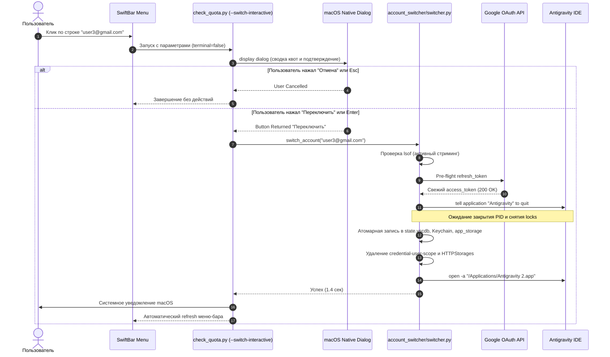

# Спецификация пользовательского интерфейса и сценариев работы: QuotaAnalytics Native Account Switcher

> **Статус:** Актуализировано (Интерактивный Zero-Button UX для SwiftBar и Web).  
> **Проект:** QuotaAnalytics  
> **Окружение:** macOS (Apple Silicon / Intel)  

---

## 1. Концепция пользовательского опыта (Zero-Button Minimalist UX)

Главный принцип — **никаких лишних строчек, дополнительных кнопок и визуального шума**.
* Каждая строчка с email в меню SwiftBar **уже является интерактивным элементом**.
* При клике на неактивный аккаунт система показывает нативный диалог подтверждения macOS.
* Случайные нажатия полностью исключены.
* Строгий моноширинный дизайн `Menlo` и выравнивание таблицы сохраняются на 100%.

---

## 2. Сценарий работы в строке меню macOS (SwiftBar)

### Внешний вид меню:
```
┌────────────────────────────────────────────────────────┐
│  74% · 4ч 39м                                          │  <- Строка меню macOS
└────────────────────────────────────────────────────────┘
  ▼ Клик мыши открывает выпадающий список:
┌───────────────────────────────────────────────────────────────────────────┐
│ user1@gmail.com (Активен)                                                 │ <- Клик: уведомление «Уже активен»
│    5ч:    [████░░░░]  59%  (2ч 53м)                                       │
│    7дн:   [████████]  88%  (6д 16ч)                                       │
│ user2@gmail.com                                                           │ <- Клик: открывает диалог подтверждения
│    5ч:    [████████] 100%  (4ч 59м)                                       │
│    7дн:   [████████] 100%  (6д 23ч)                                       │
│ user3@gmail.com                                                           │ <- Клик: открывает диалог подтверждения
│    5ч:    [████████] 100%  (4ч 59м)                                       │
│    7дн:   [████████] 100%  (6д 23ч)                                       │
│    Argon: [█░░░░░░░]  14%  (4д 5ч)                                        │
│ ...                                                                       │
│ ───────────────────────────────────────────────────────────────────────── │
│ 📊 Открыть Liquid Glass Dashboard...                                      │
│ 🔄 Принудительно обновить квоты                                          │
└───────────────────────────────────────────────────────────────────────────┘
```

### Интерактивный диалог подтверждения macOS (AppleScript Dialog):
Когда пользователь кликает на строку с любым неактивным аккаунтом (например, `user3@gmail.com`), в центре экрана поверх всех окон появляется нативное диалоговое окно macOS:

```
┌────────────────────────────────────────────────────────────────────────┐
│  ⚠️  Переключение аккаунта Antigravity                                 │
│                                                                        │
│  Действительно ли вы хотите переключить Antigravity на:                │
│  user3@gmail.com?                                                      │
│                                                                        │
│  Текущие лимиты профиля:                                               │
│  • 5 часов: 100% (4ч 59м)                                              │
│  • 7 дней:  100% (6д 23ч)                                              │
│  • Argon:   14%  (4д 5ч)                                               │
│                                                                        │
│  Antigravity IDE будет безопасно перезапущена.                         │
│                                                                        │
│                     [ Отмена ]    [ Переключить ]                      │
└────────────────────────────────────────────────────────────────────────┘
```

1. **Если пользователь нажал «Отмена» (или `Esc`):**
   * Скрипт мгновенно завершается. Никаких изменений не вносится, Antigravity IDE продолжает работу.
2. **Если пользователь нажал «Переключить» (или `Enter`):**
   * Скрипт проверяет сокеты `language_server` (нет ли активной генерации кода).
   * Если идет генерация — выдает системный алерт: *«Агент сейчас генерирует ответ! Дождитесь завершения»*.
   * Делает Pre-flight Refresh токена через Google OAuth.
   * Мягко закрывает Antigravity IDE через AppleScript.
   * Атомарно записывает учетные данные во все 4 хранилища (`state.vscdb`, Keychain, `app_storage.json`, сносит `credential-user-scope`).
   * Запускает IDE заново.
   * Отправляет системный баннер macOS:  
     `✅ Аккаунт Antigravity переключен на user3@gmail.com`.
   * Меню SwiftBar автоматически обновляется (`refresh=true`): бейдж `(Активен)` перемещается на выбранный аккаунт.

---

## 3. Сценарий работы в Liquid Glass Dashboard

На веб-панели `dashboard.html`:
* В заголовке каждой карточки аккаунта:
  * Активный аккаунт отображает пульсирующий синий бейдж `● АКТИВЕН`.
  * Резервные аккаунты содержат аккуратную кнопку в стиле неоморфизма/стекла: `⚡ Сделать активным`.
* При клике на кнопку всплывает стеклянный модальный попап с аналогичным подтверждением и кнопками `[Отмена]` / `[Подтвердить]`.
* Запрос уходит на REST-эндпоинт `POST /api/switch?email=...`, после чего карточки на дашборде обновляются вживую без перезагрузки страницы.

---

## 4. Сценарий работы в CLI (Терминал)

```bash
# Интерактивный режим (с диалогом подтверждения macOS):
python3 check_quota.py --switch-interactive user3@gmail.com

# Прямой режим (для автоматизаций, cron и bash-скриптов):
python3 check_quota.py --switch user3@gmail.com
python3 check_quota.py --switch 3

# Принудительный режим (игнорировать предупреждение об активном стриминге):
python3 check_quota.py --switch 3 --force
```

---

## 5. Диаграмма последовательности действий (Mermaid Sequence)


